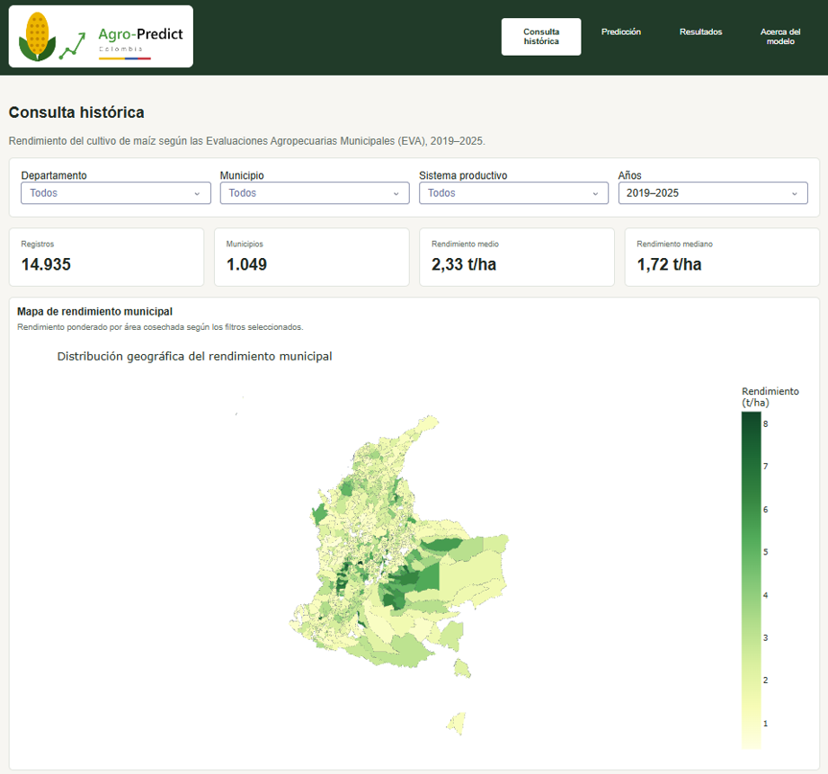
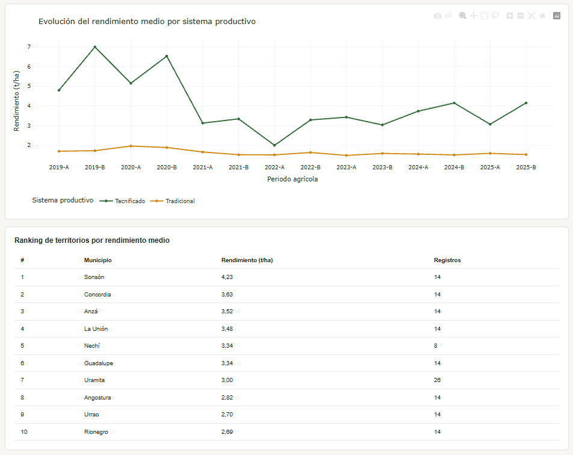
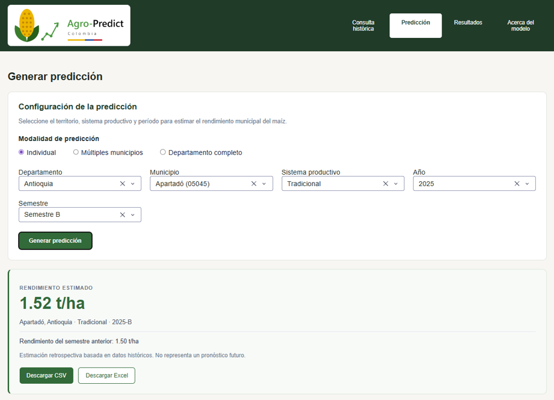
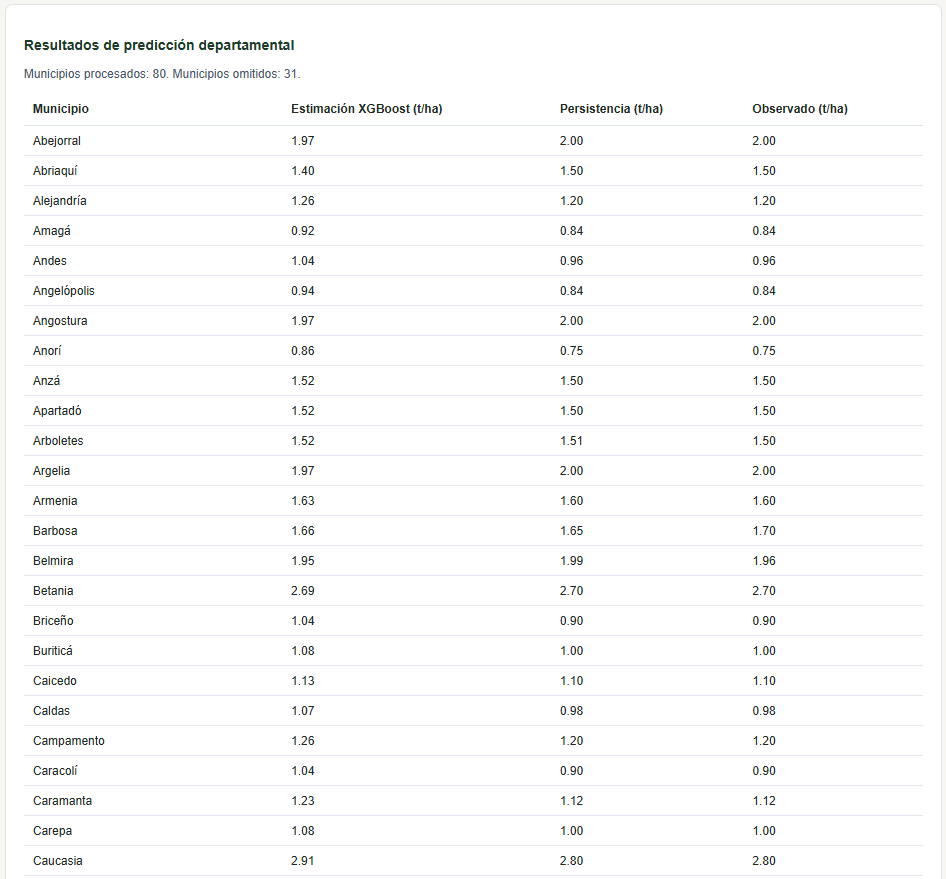
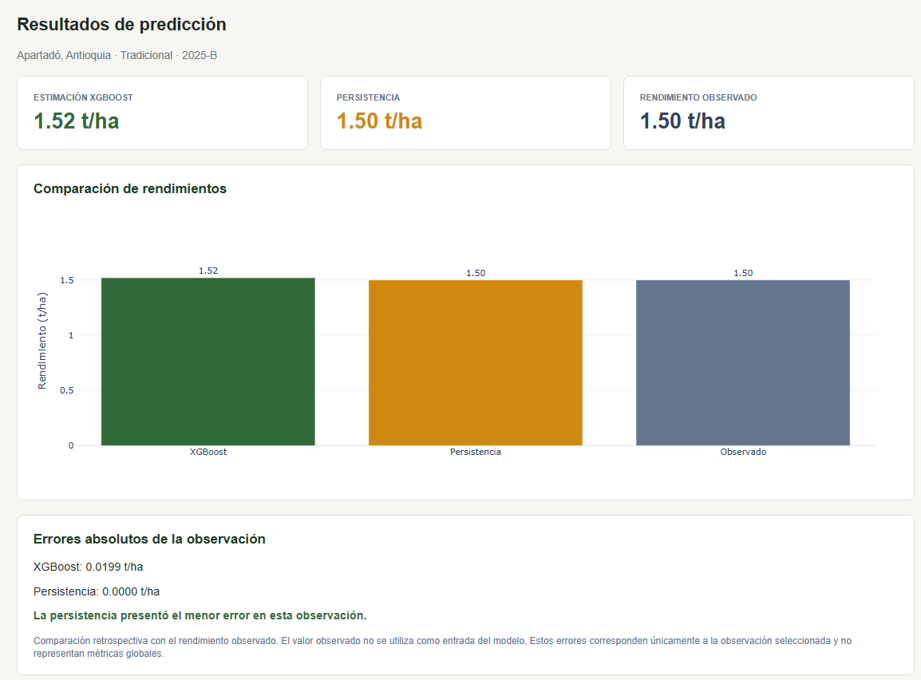
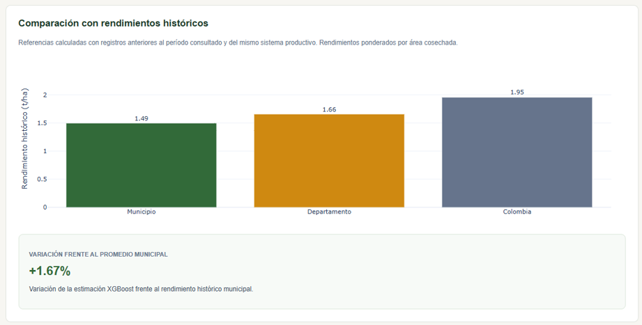
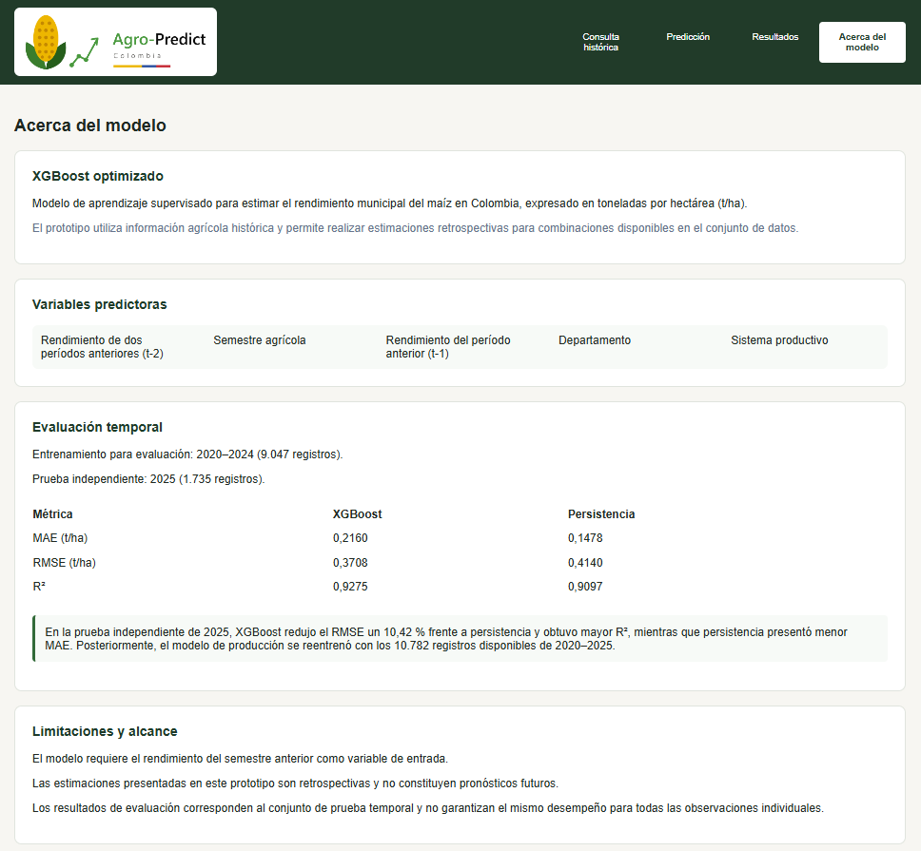

# Manual de usuario del tablero — AgroPredict Colombia

## 1. ¿Para qué sirve el tablero?

AgroPredict Colombia es un prototipo para **consultar y estimar el rendimiento del cultivo de maíz por municipio** (toneladas por hectárea, t/ha). Usa la información de las Evaluaciones Agropecuarias Municipales (EVA) de la UPRA, 2019–2025.

Está pensado para analistas y planificadores agropecuarios que necesitan:

- Explorar cómo ha sido el rendimiento del maíz en un territorio y compararlo con otros.
- Obtener una estimación del rendimiento de un municipio, de varios municipios o de un departamento completo para un semestre.
- Comparar esa estimación con el rendimiento realmente observado y con una regla simple de referencia (la *persistencia*).

> **Importante.** Las estimaciones son **retrospectivas**: se calculan para semestres que ya ocurrieron y para los que existe información de los dos semestres anteriores. Sirven para evaluar y entender el modelo; **no son un pronóstico de cosechas futuras**.

## 2. Cómo ingresar

Abra en el navegador la dirección del tablero:

- En un computador local: `http://localhost:8050`
- En el servidor desplegado: `http://IP_PUBLICA:8050` *(completar con la dirección definitiva)*

No requiere usuario ni contraseña. En la parte superior aparecen cuatro pestañas, que siguen el orden natural de uso:

| Pestaña | Para qué se usa |
|---|---|
| **Consulta histórica** | Explorar los datos reales de 2019–2025 con filtros, mapa, gráfico y ranking |
| **Predicción** | Configurar y generar estimaciones con el modelo |
| **Resultados** | Comparar la última predicción individual con lo observado y con la historia |
| **Acerca del modelo** | Conocer el modelo, sus variables, su evaluación y sus limitaciones |

## 3. Pestaña «Consulta histórica»

En esta pestaña el usuario interactúa con los filtros para **identificar el rendimiento del cultivo de maíz** según las Evaluaciones Agropecuarias Municipales.

### 3.1 Cómo usarla

1. Elija un **Departamento** (o déjelo en *Todos* para ver el país completo).
2. Si quiere, elija un **Municipio**. La lista solo muestra los municipios del departamento elegido.
3. Elija el **Sistema productivo**: *Tradicional* o *Tecnificado* (o *Todos*).
4. Elija los **Años**: todo el periodo 2019–2025 o un año específico.

Todo el contenido de la pestaña se actualiza al cambiar cualquier filtro.

### 3.2 Qué muestra

- **Indicadores**: número de **registros**, número de **municipios**, **rendimiento medio** y **rendimiento mediano** de la selección.
  > Cuando la media es bastante mayor que la mediana (por ejemplo 2,33 frente a 1,72 t/ha para todo el país) significa que unos pocos municipios con rendimientos muy altos "jalan" el promedio hacia arriba. La mediana representa mejor al municipio típico.
- **Mapa de rendimiento municipal**: colorea cada municipio según su rendimiento, ponderado por área cosechada. Entre más oscuro el verde, mayor rendimiento. Al pasar el cursor sobre un municipio se ve su detalle.
- **Gráfico histórico**: evolución del rendimiento medio en cada periodo agrícola (2019-A a 2025-B), con una línea por sistema productivo.
- **Ranking de territorios**: tabla con los territorios de mayor rendimiento medio y el número de registros de cada uno. Cuando se filtra un departamento, el ranking muestra sus municipios.

*Ejemplo con Antioquia:* el sistema **tecnificado** rinde bastante más que el **tradicional** y varía mucho de un semestre a otro (entre 2 y 7 t/ha), mientras que el tradicional se mantiene casi plano, alrededor de 1,5 a 2 t/ha. En el ranking aparecen arriba Sonsón, Concordia y Anzá. La columna *Registros* sirve para saber cuánta historia respalda cada promedio: un municipio con pocos registros (como Nechí, con 8) tiene un promedio menos confiable que uno con 14 o más.

> **Nota sobre los registros.** La consulta histórica muestra todos los registros de la base (14.935). El modelo solo puede usar los que tienen información de los dos semestres anteriores (10.782), por eso no todos los municipios y periodos están disponibles en la pestaña *Predicción*.

## 4. Pestaña «Predicción»

Aquí el usuario genera una **predicción individual, de múltiples municipios o de un departamento completo**, y obtiene un rendimiento estimado basado en los datos históricos. Los resultados se pueden **descargar en CSV o en Excel**.

### 4.1 Elegir la modalidad

| Modalidad | Cuándo usarla | Resultado |
|---|---|---|
| **Individual** | Analizar un municipio en detalle | Tarjeta con la estimación; el detalle completo queda en la pestaña *Resultados* |
| **Múltiples municipios** | Comparar varios municipios de un mismo departamento | Tabla con una fila por municipio |
| **Departamento completo** | Revisar todos los municipios de un departamento | Tabla con todos los municipios que tengan datos suficientes |

### 4.2 Completar los campos

Los campos se llenan **en cascada**: cada lista muestra solo las opciones que tienen datos según lo elegido en la anterior.

1. **Departamento**
2. **Municipio** (uno o varios según la modalidad; no aplica en *Departamento completo*)
3. **Sistema productivo**
4. **Año**
5. **Semestre** (A o B)

Luego pulse **Generar predicción**. Si falta algún campo, el tablero muestra el aviso *"Complete todos los campos antes de generar las predicciones."*

### 4.3 ¿Qué hace el tablero al pulsar el botón?

Para cada municipio, el tablero busca en los datos históricos el rendimiento del **semestre anterior (t-1)** y el de **dos semestres atrás (t-2)**, junto con el semestre, el departamento y el sistema productivo. Envía esa información al servicio de predicción (API), que responde con la estimación del modelo.

> Es parecido a estimar las ventas de la próxima quincena de un negocio mirando las dos quincenas anteriores y ajustando según la región y el tipo de negocio.

### 4.4 Resultado individual

Aparece la tarjeta **RENDIMIENTO ESTIMADO** con:

- el valor estimado en t/ha,
- el municipio, departamento, sistema y periodo consultados,
- el rendimiento del semestre anterior como referencia,
- los botones **Descargar CSV** y **Descargar Excel**.

*Ejemplo:* Apartadó (Antioquia), sistema tradicional, 2025-B → estimación de **1,52 t/ha**; el semestre anterior había rendido 1,50 t/ha.

### 4.5 Resultado múltiple o departamental

Se muestra una tabla con:

| Columna | Significado |
|---|---|
| Municipio | Nombre del municipio |
| Estimación XGBoost (t/ha) | Lo que estima el modelo |
| Persistencia (t/ha) | Regla de referencia: "este semestre rendirá igual que el anterior" |
| Observado (t/ha) | Rendimiento real reportado en la EVA |

La tabla se puede descargar en **CSV** o **Excel**. El archivo incluye además el código DANE, el departamento, el sistema productivo, el año y el semestre.

Encima de la tabla se indica cuántos municipios se **procesaron** y cuántos se **omitieron**. Un municipio se omite cuando no tiene información de los dos semestres anteriores para el sistema y periodo elegidos. Si ninguno cumple, aparece *"No se encontraron registros válidos para los municipios y el período seleccionados."*

*Ejemplo:* Antioquia, sistema tradicional, 2025-B → 80 municipios procesados y 31 omitidos. Al leer la tabla se notan dos cosas:

- En la mayoría de municipios el valor **observado es idéntico a la persistencia** (por ejemplo Abejorral 2,00 y 2,00; Andes 0,96 y 0,96). Es decir, el rendimiento reportado no cambió frente al semestre anterior.
- El modelo tiende a **acercar las estimaciones a valores típicos**: sube un poco los rendimientos bajos (Briceño: 0,90 → 1,04) y baja un poco los altos (Abejorral: 2,00 → 1,97). Es un comportamiento esperado en un modelo que aprende de muchos municipios a la vez.

## 5. Pestaña «Resultados»

Esta vista permite **comparar el resultado del modelo con la persistencia y con el rendimiento observado**, y además **con los rendimientos históricos** del territorio. Muestra la última predicción **individual**; si aún no se ha generado ninguna, aparece *"Genere primero una predicción en la pestaña Predicción."*

### 5.1 Comparación con lo observado

- **Tres tarjetas**: Estimación XGBoost, Persistencia y Rendimiento observado.
- **Comparación de rendimientos**: gráfico de barras con los tres valores.
- **Errores absolutos de la observación**: cuánto se alejó cada método del valor real y cuál acertó mejor *en este caso*.

El valor observado **no** se usa para calcular la estimación: solo se muestra después, para comparar.

### 5.2 Comparación con los rendimientos históricos

- Promedio histórico del **municipio**, del **departamento** y de **Colombia**, calculado con registros anteriores al periodo consultado y del mismo sistema productivo, ponderados por área cosechada.
- **Variación frente al promedio municipal**: cuánto sube o baja la estimación respecto a lo que históricamente ha rendido ese municipio.

### 5.3 Cómo leer los resultados — ejemplo de Apartadó 2025-B

| | Valor |
|---|---|
| Estimación XGBoost | 1,52 t/ha |
| Persistencia | 1,50 t/ha |
| Observado | 1,50 t/ha |

En este caso la persistencia acertó exactamente (error 0) y el modelo se desvió solo 0,02 t/ha. Esto ocurre porque el rendimiento reportado en 2025-B es **idéntico** al del semestre anterior, algo frecuente en la fuente de datos. La estimación quedó 1,67 % por encima del promedio histórico del municipio (1,49 t/ha) y por debajo del promedio departamental (1,66) y nacional (1,95).

Recomendaciones:

- Que el modelo gane o pierda frente a la persistencia **en un caso puntual** es normal. La calidad del modelo se mide sobre muchos casos (ver *Acerca del modelo*).
- Una variación grande frente al promedio histórico puede indicar un municipio con cambios recientes (clima, tecnificación, área sembrada) y merece revisarse con información adicional.

## 6. Pestaña «Acerca del modelo»

Presenta lo más relevante del modelo de aprendizaje utilizado para estimar el rendimiento municipal del maíz en Colombia.

- **Modelo**: XGBoost optimizado (aprendizaje supervisado), con resultados en t/ha.
- **Variables predictoras**: rendimiento del periodo anterior (t-1), rendimiento de dos periodos atrás (t-2), semestre agrícola, departamento y sistema productivo.
- **Evaluación temporal**: cuántos registros se usaron para entrenar (2020–2024) y cuántos para la prueba independiente (2025), sin mezclar el futuro con el pasado.
- **Métricas** del modelo frente a la persistencia:
  - **MAE**: error promedio, en t/ha.
  - **RMSE**: error que castiga más las equivocaciones grandes, en t/ha.
  - **R²**: qué tanto de la variación del rendimiento logra explicar el modelo (más cercano a 1 es mejor).
- **Limitaciones y alcance** del prototipo.

## 7. Limitaciones que el usuario debe conocer

- Las estimaciones son **retrospectivas**: no se pueden pedir semestres futuros.
- Se necesita el rendimiento de **los dos semestres anteriores**. Municipios con historia incompleta no se estiman.
- El modelo no usa clima, precios ni área sembrada; solo la historia del rendimiento y el contexto (departamento, sistema productivo y semestre).
- En la fuente hay registros que repiten exactamente el rendimiento del semestre anterior (como en el ejemplo de Apartadó). En esos casos la persistencia acierta y puede tener un error promedio (MAE) menor que el modelo, aunque el modelo comete menos errores grandes (menor RMSE).

## 8. Preguntas frecuentes

**El tablero dice que no hay datos para mi selección.**
Pruebe con otro año o sistema productivo. No todos los municipios reportan ambos sistemas en todos los semestres.

**La predicción tarda o muestra un error.**
El tablero depende del servicio de predicción (API). Informe al administrador para que verifique que esté activo (ver *Manual de instalación*).

**¿Puedo cargar mis propios datos?**
No en esta versión. El prototipo trabaja con la base EVA incluida en el proyecto.
